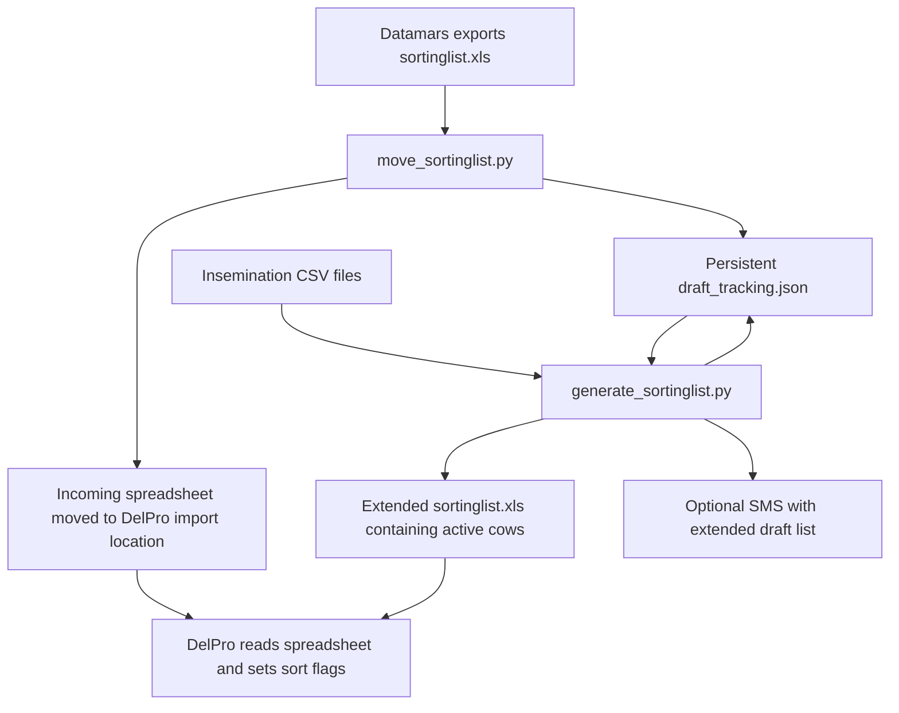

# Extended drafting from Datamars to DelPro

These scripts extend the farm's Datamars-to-DelPro sorting-list workflow so cows
can continue to be drafted across milkings until insemination is recorded or their
36-hour drafting period expires.

In the original workflow, cows were only drafted for one milking. This project
adds a persistent list of cows still awaiting insemination and republishes that
list to DelPro at scheduled times. A cow does not have to appear in every new
Datamars export to remain on the extended list.

## How the workflow fits together



Datamars writes the incoming file to:

```text
C:\delaval-spreadsheet\sortinglist.xls
```

The mover records incoming cows in the tracking database, then moves that file to:

```text
C:\delaval-spreadsheet\sortuntilinsem\sortinglist.xls
```

DelPro is configured separately to read the spreadsheet at that destination and
set the sort flags for the listed cows. The generator also writes to that same
destination, replacing its contents with the current extended draft list.

**DelPro's import is not a complete replacement of all sort flags.** In this
farm's setup, importing a blank/header-only file leaves existing flags set. A cow
being omitted from a later spreadsheet does not itself explicitly clear her
DelPro flag. These scripts stop including expired or inseminated cows in future
extended lists; they do not send an explicit flag-clear command to DelPro.
DelPro's own flag lifecycle and import configuration remain part of the workflow.

## What each script does

### `move_sortinglist.py` — receive the Datamars list

The mover is normally scheduled every minute. Each launch checks for a new
incoming `sortinglist.xls` and exits without changing data if none is present.
When a file is available, it:

1. Reads the first worksheet. The expected first row contains field codes
   `300001` (cow number) and `300096` (draft flag). Subsequent rows contain a cow
   number and flag; only rows with flag `1` enter tracking.
2. Loads the existing tracking database and adds or updates those cows.
3. Saves the database safely, retaining a backup of the previous version.
4. Moves the incoming file into `sortuntilinsem` for DelPro to read, replacing
   the destination file if one exists.

A cow absent from the incoming export is **not removed** from the database.
A header-only export adds no cows and still passes through to DelPro. It does
not empty the persistent extended list.

### `generate_sortinglist.py` — maintain and publish extended drafting

The generator runs at the farm's chosen drafting/import times. Each run:

1. Loads the persistent list and reads insemination CSVs from `InseminatedCows`.
2. Marks active cows inactive if their current drafting period is more than
   36 hours old or their cow number appears in an insemination CSV.
3. Removes inactive database records more than 30 days after their recorded
   removal time.
4. Saves the tracking database, then moves successfully processed insemination
   CSVs into `InseminatedCows\processed`.
5. Creates a spreadsheet containing all remaining active cows, sorted by number,
   with draft flag `1` for each cow.
6. Uses Microsoft Excel COM automation to save a genuine Excel 97–2003 BIFF8
   `.xls` file at the DelPro import location.
7. Optionally sends an SMS listing the active cows through Twilio.

Expiry and insemination updates happen when the generator runs, rather than
continuously. The code checks expiry first, so a cow matching both conditions in
one run is recorded with reason `timeout_36h`.

The generator creates a temporary `temp_sort.xlsx` before converting it to `.xls`.
It uses real Excel for this conversion; renaming an `.xlsx` file to `.xls` is not
equivalent.

### `tracking_store.py` — protect shared data and record diagnostics

Both scheduled scripts use this shared helper. It provides:

- A shared process lock around the entire run, including spreadsheet operations.
  If both scripts start together, one waits for the other. A wait exceeding
  120 seconds fails with an error rather than allowing overlapping updates.
- Validation that stops processing when tracking data is missing, unreadable or
  malformed, instead of silently starting an empty database.
- A backup before each database save, followed by a flushed temporary file and
  atomic replacement of the tracking JSON.
- Daily diagnostic logs with unique run IDs and process IDs. Appends to a shared
  daily log are also locked across processes.

This lock coordinates these Python scripts only. Datamars and DelPro do not use
it. The mover currently does not wait for the incoming file to become stable or
coordinate with Datamars while it writes. The integration should arrange for
completed exports to be available before the mover processes them.

## Drafting rules and cow history

| Cow state when received | Action | Start of 36-hour period |
| --- | --- | --- |
| New cow | Add an active record | Time the mover processes her incoming list |
| Already active | Update `last_seen`, keep active | Preserve the existing `first_seen` |
| Previously inactive | Reactivate and clear previous removal fields | Reset `first_seen` to the new arrival time |
| Absent from a new export | Keep her existing record | Unchanged |
| Insemination recorded | Generator marks inactive | No longer included in extended output |
| More than 36 hours old | Generator marks inactive | No longer included in extended output |

For example, a cow received at 5:00 pm remains on the extended list at subsequent
generator runs even if she disappears from later Datamars exports. She stays
active until an insemination CSV identifies her or a generator run finds that
more than 36 hours have elapsed. Repeated exports during that period do not
continually extend her timer.

If that cow later returns after becoming inactive, she gets a **new 36-hour
period**. This prevents a timer from an earlier drafting episode from removing
her prematurely. The correction applies to future reactivations; it does not
automatically restore cows already removed incorrectly.

Each tracking record includes `first_seen`, `last_seen`, `active`,
`cleared_reason` and `cleared_time`. Inactive records are retained for 30 days
unless the cow returns and that record is reactivated. Pre-save backups and logs
preserve earlier record states. Timestamps use the Windows computer's local time.

## Files and installation

Install the three runtime files together in `C:\Scripts`:

```text
C:\Scripts\
    move_sortinglist.py
    generate_sortinglist.py
    tracking_store.py
```

The configured data locations are:

| Location under `C:\delaval-spreadsheet` | Purpose |
| --- | --- |
| `sortinglist.xls` | Incoming Datamars export |
| `sortuntilinsem\sortinglist.xls` | Spreadsheet DelPro reads; written by both scripts |
| `draft_tracking.json` | Persistent cow tracking and removal records |
| `draft_tracking.json.backups\` | Previous database versions |
| `draft_tracking.json.lock` | Shared runtime lock file |
| `InseminatedCows\` | Incoming insemination CSVs |
| `InseminatedCows\processed\` | Archived CSVs whose updates were committed |
| `sms_config.json` | Local SMS settings and credentials |
| `logs\` | Daily mover and generator logs |

Insemination CSVs must put cow numbers in the first column. The parser supports
comma or semicolon delimiters and an optional first-row header containing
`Animal Number` in its first cell. Invalid cow-number rows are skipped and logged.
Producing these exports is an external part of the farm's workflow; the scripts
do not fetch insemination records directly from an API.

Runtime requirements are Windows, Python, installed Microsoft Excel, and the
Python packages `xlrd`, `openpyxl`, `pywin32` and `twilio`. The scheduled-task
account needs access to the data folders and the ability to automate Excel.
Datamars exports and DelPro imports must already be configured separately.

See [installation, backup and recovery instructions](INSTALL_FIX.md) before
replacing scripts. Keep production tracking data and SMS credentials out of Git.
A missing database intentionally stops processing; do not replace an existing
one with `{}` to bypass an error.

## Scheduling

Configure two Windows scheduled tasks using the installed Python interpreter:

```text
python C:\Scripts\move_sortinglist.py
python C:\Scripts\generate_sortinglist.py
```

For the mover, use one daily trigger repeating every minute **for one day**, and
select **Do not start a new instance** if the task is already running. Avoid
stacking daily triggers with indefinite repetition. Check Task Scheduler History
to confirm that the mover launches once per minute.

Schedule the generator at the times required for the farm's milking and DelPro
import workflow. Earlier logs showed runs at 3:00 am, 5:00 am, 12:30 pm and
3:00 pm; these times are configured in Task Scheduler, not hard-coded in Python.
The scripts execute once per launch; they do not install or change scheduled
tasks. Their shared lock protects updates if their schedules coincide.

## SMS notifications

When enabled in the local `sms_config.json`, the generator sends:

```text
Heat draft (3): 2923, 3276, 3482
AI 13 Nov 18:00 (est. windows)
In window: 2923
Priority: 2923
Past window: 3482
```

Configuration uses `sms_enabled`, `twilio_sid`, `twilio_token`, `twilio_from` and
`recipients`. Keep actual credentials and phone numbers only in the local file.
Missing or disabled configuration skips SMS; an empty active list also produces
no SMS. Notifications describe the generated active list, not confirmed physical
drafting or DelPro import success. `SMS_ACCEPTED` in a log means Twilio accepted
the request, not that the handset has received it.

The first count is the total active extended draft list, including cows retained
from earlier milkings. The `In window` line estimates which of those cows will be in
their optimum window at the next planned **8:00 am or 6:00 pm AI session**. These
are approximate AI times supplied by the operator, not milking/import times.
The generator chooses the next session from the Windows local clock; after the
evening session it uses 8:00 am the next day. At exactly a session time it uses
that session. The example above illustrates the message format, not live cow data.

### Estimated optimum-window timing

Datamars' actual optimum-window times are not available in the incoming export.
The operator supplied three examples which were compared with mover logs:

| Cow | Arrival in tracking | Reported optimum window | Delay to start |
| --- | --- | --- | --- |
| 2923 | 13 Nov 2026, 04:00:38 | 13 Nov, 11:59–22:59 | 7 h 58 min |
| 3276 | 13 Nov 2026, 15:04:38 | 13 Nov, 23:42–14 Nov, 10:42 | 8 h 37 min |
| 3482 | 12 Nov 2026, 19:28:38 | 13 Nov, 04:13–15:13 | 8 h 44 min |

All three reported windows lasted 11 hours. The SMS therefore uses a rough window
of **first_seen +8.5 hours to first_seen +19.5 hours**, and counts a cow if the
next AI session falls within that interval, including either endpoint. The
matching cow numbers are listed. The SMS also identifies **Priority**:
active cows in their estimated window at the coming session whose window ends
before the following session. These are the cows most likely to miss their window if they are not caught this time.
Cows whose windows end before the coming session are listed separately as
**Past window**. Neither label overrides the actual Datamars
window or removes cows from the draft list. A window ending exactly at a session
is counted as covering that session.

Missing/unusable arrival times are reported as
`Timing unknown`, rather than counted as known misses.

This estimate is calibrated from only three examples. The arrival timestamp is
when the mover first processed the cow, not observed heat onset or the actual
Datamars window. Export delays and variation between cows can affect it. Treat
the count as a planning aid and check actual Datamars timings when deciding AI
timing. The script does not infer a new biological window from every sighting.
It uses the current drafting episode's first_seen, including the fresh timestamp
when an inactive cow returns.

This feature changes **SMS content only**. It does not filter the spreadsheet,
remove cows, reset timers, or change the 36-hour drafting/insemination rules.
Already-inactive cows are not in the SMS input list. The model constants and AI
hours are near the top of generate_sortinglist.py. Changing the SMS send schedule
still requires editing the Windows scheduled task. Longer lists/messages may be
sent as multiple SMS segments.

The logs record `AI_WINDOW_ESTIMATE` entries for each cow and an
`AI_SESSION_ESTIMATE` summary when SMS is enabled and configured. These label
predictions explicitly and record the arrival time, estimated start/end and
chosen session for later comparison with Datamars.

## Investigating a missing cow

Daily files are written automatically to:

```text
C:\delaval-spreadsheet\logs\move_sortinglist_YYYYMMDD.log
C:\delaval-spreadsheet\logs\generate_sortinglist_YYYYMMDD.log
```

Search both logs for the cow number and follow the run IDs. The logs record
incoming cow lists, additions and reactivations, preserved/reset timers, each
cow's age, insemination matches, removal reasons, database commits, backup names,
spreadsheet writes and failures. A `COW_REMOVAL_PENDING` entry becomes persistent
only when that run reaches `DB_COMMITTED`.

Compare the current tracking record with the logs and backups from the last
correct list through the first incorrect one. Preserve processed insemination
CSVs for comparison. `RUN_SUCCESS` confirms the script finished, not that DelPro
read the output or the cow was physically drafted. If Python never starts, check
Task Scheduler History; there will be no script run log. A run interrupted by a
power loss or process termination may have no finish entry.

Logs and database backups are not automatically deleted. Monitor disk space and
archive older files. Never bulk-reactivate inactive cows or reset all timers to
repair a missing-cow incident; reconcile the cow's actual return time and
insemination status first.

## Tests

From the repository directory, run:

```text
python -m unittest -v test_tracking
```

The 23 automated tests cover concurrent updates, locking, corrupted databases,
backup/write failures, shared daily logging, SMS-log redaction, and drafting
rules. Regression tests confirm that a returning inactive cow gets a new timer,
that repeated active sightings do not extend it, and that expiry still happens
after 36 hours. Tests use temporary data and simulated spreadsheet operations;
they do not send live SMS or modify production files. Actual Excel automation,
Windows locking and DelPro import behaviour need checks on the farm's computer.


The compact SMS uses short labels and omits repeated counts and per-cow end
times; full estimated start/end times remain in the logs. `Priority` means
currently estimated in-window cows whose window ends before the following AI
session. `Past window` means estimated to be past the window by the named session.
The three-cow example fits within 160 characters; longer cow lists can still
require multiple SMS segments. All timing lines are estimates.
